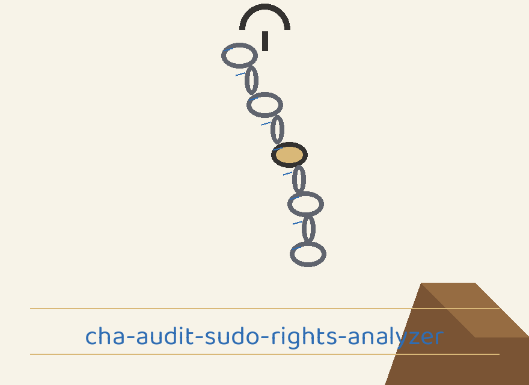

> Register leaf plate: Room 1. The chain link glyph sits beside this heading only, over a thin sand coloured ruling.

# cha-audit-sudo-rights-analyzer

# cha-audit-sudo-rights-analyzer
Analyzes sudoers file for overly permissive or insecure sudo rights assignments, highlighting potential privilege escalation vulnerabilities. - Focused on Audits system configuration settings against security hardening benchmarks (e.g., CIS benchmarks). Checks for insecure configurations and generates reports with recommendations for remediation. Supports various operating systems (Windows, Linux, macOS).

> Door card: A fault carried over from the README. The sentence after the dash in the line above, about benchmarks such as CIS benchmarks, reports with recommendations for remediation, and Windows, Linux, and macOS, is a graft. main.py reads one sudoers file, and the only grants it flags are exact ALL grants, as the callouts below record.

## Install
`git clone https://github.com/ShadowGuardAI/cha-audit-sudo-rights-analyzer`

> Door card: The Name Is Missing Its Hyphen. The organisation in the clone line above is written ShadowGuardAI, without its hyphen. The line stands as printed, and the fault is named here rather than tidied away. The README gives no change of directory step, no dependency step, and no launch instruction, and requirements.txt in the repository is empty.

## Usage
`./cha-audit-sudo-rights-analyzer [params]`

The repository ships no executable of that name. The entry point present in the code is main.py, and the examples at the foot of main.py run the script with a -f path, an optional -o report path, and an optional -v flag.

## Parameters
- `-h`: Show help message and exit
- `-f`: No description provided
- `-o`: No description provided
- `-v`: Enable verbose output

The parser in main.py gives -f, also written --sudoers_file, a default of /etc/sudoers, and -o, also written --output_file, an optional output path. The README list above gives both flags the words No description provided, and that silence stands as printed.

> Door card: Only an Exact ALL Is Flagged. Comment lines and empty lines are skipped, lines that are not user specifications are skipped, and the command part of each remaining line is compared on its own. A line whose command part is exactly ALL earns the finding User/Group can run any command as root, consider restricting. If that same line also carries NOPASSWD: it earns a second finding, NOPASSWD for all commands found, this poses a security risk. Wildcard paths, shell escaping editors or pagers, and a single command granted as root with NOPASSWD all pass unseen.

> Door card: Drop in files are never opened. Include lines are met as comment shaped lines and skipped, so files pulled in by those lines are never read. Only the one named file is read. A missing file ends the run with exit 1, a file that cannot be read returns no result and ends the run with exit 1, and a report that cannot be written also ends the run at exit 1. When no findings exist, No vulnerabilities found. prints only in verbose mode.

## License
Copyright (c) ShadowGuardAI

> Door card: The Name Is Missing Its Hyphen. The closing line above repeats the unhyphenated organisation name and names no licence. The repository also carries a separate LICENSE file headed MIT License.

